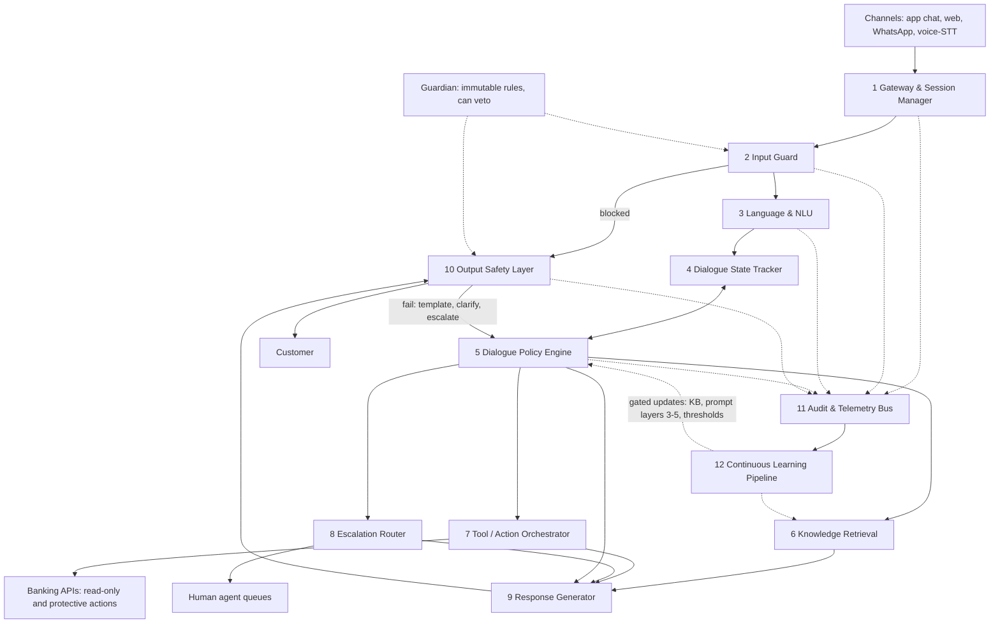

# NexBank Agentic AI Customer Service Agent with Feedback Loops

A specification-first design for a production-grade, self-improving AI customer service system for **NexBank**, a fictional Indian neo-bank (2.7M customers, ~18,000 interactions/day).

> Status: Days 1-15 are complete. The specification covers Levels 1-7. **Nothing is built or executed**: every test, simulation and metric value is specified, simulated or a proposal, and is labelled as such. No test case, A/B experiment or load test has been run, and no agent exists to run one against. Hindi, Hinglish and Gujarati wording is not native-reviewed, and no committee has reviewed any layer. Transfer of the repository to @ZethetaIntern is pending, to be done by the repository owner. Open items are listed under [Known limitations](#known-limitations); the daily record is [CHANGELOG.md](CHANGELOG.md).

## Overview

The system answers banking customer queries in English, Hindi and Hinglish, takes only protective actions, keeps advice and money movement out of reach of the model, escalates to humans by a fixed set of triggers, and improves from supervisor corrections, CSAT and outcomes behind fixed safety gates. The repository holds the architecture, the data and configuration files, the guardrails, the test cases, the validators and 32 designed conversations. It holds no running code beyond the validators.

### Targets

| Metric | Target |
|---|---|
| Containment rate | >= 70% |
| CSAT | >= 4.5 / 5 |
| Incorrect financial advice | 0% |
| First reply | < 30 s (engineering budget < 3 s p95 per turn; see decision D-07) |
| KB retrieval p95 latency | < 200 ms |
| First contact resolution (FCR) | >= 70% |
| Escalation rate | < 30% |
| Average handle time (AHT) | < 8 min |

These are the brief's targets. They are design aims; none has been measured.

## Architecture summary

Five principles (`docs/architecture/system-architecture.md` section 1): safety is structural and not prompted; fail closed; least privilege for every agent and tool; facts come from systems of record and never from model memory; every turn is auditable.

Twelve components (the brief requires at least 8). Contracts, message shapes and latency budgets are in `docs/architecture/component-interfaces.md`.

| # | Component | Responsibility |
|---|---|---|
| 1 | Gateway & Session Manager | Channel adapters, rate limits, session lifecycle, 5-minute inactivity timeout, DoS defence |
| 2 | Input Guard | Prompt-injection and jailbreak detection, credential and PII capture blocking, crisis detection |
| 3 | Language & NLU Service | Language detection and code-switching, hierarchical intent, entities, sentiment and emotion |
| 4 | Dialogue State Tracker | Authoritative per-conversation state (`config/dialogue_state.schema.json`) |
| 5 | Dialogue Policy Engine | Deterministic rules first, learned ranking second; owns the orchestrator role |
| 6 | Knowledge Retrieval | Hybrid dense and BM25 retrieval with re-ranking, filtered by auth level |
| 7 | Tool/Action Orchestrator | Calls banking APIs (read-only plus protective actions with confirmation); idempotency and timeouts |
| 8 | Escalation Router | Evaluates triggers, picks queue and priority, builds the handoff package |
| 9 | Response Generator | Template, LLM or hybrid generation with persona and length calibration |
| 10 | Output Safety Layer | Accuracy, compliance, PII, grounding, tone, commitment and advice-boundary checks |
| 11 | Audit & Telemetry Bus | Encrypted conversation and turn logs, metrics, dashboards, regulatory reports |
| 12 | Continuous Learning Pipeline | Supervisor corrections, CSAT and outcomes, evaluation gates, staged rollout |

The same flow as a diagram (source: `diagrams/architecture.mmd`; GitHub renders Mermaid blocks, and any Mermaid viewer opens the `.mmd` files):

## Setup and how to verify

There is nothing to install, build or deploy. The only executable files are seven validator scripts. They need Python 3 and PyYAML (`pip install pyyaml`); `jsonschema` is optional; `tests/compliance/validate_compliance.py` uses it when it can be imported. Run every command from the repository root.

| Command | What it checks |
|---|---|
| `python tests/validate_crossrefs.py` | Repo-wide cross-references: cited paths and section numbers exist, every cited ID is defined, counts stated here match the files, no placeholder text, ASCII-only English text |
| `python tests/kb/validate_kb_entries.py` | The 77 knowledge base entries: schema, intent links, figure allow-list, gap entries |
| `python tests/escalation/validate_escalation.py` | The 15 triggers against the brief, queues, SLAs, the 64 escalation test cases and the Level 6 boss |
| `python tests/safety-suite/validate_manifest.py` | The fixed safety suite: 356 cases indexed, coverage, and the hash lock (`--rebuild --accept-change <ID> --decision <D-id>` records an accepted change) |
| `python tests/templates/validate_templates.py` | The 73 templates, the parameters and the six prompt layers, with the wording lint |
| `python tests/simulations/validate_simulations.py` | The 32 conversations: structure, identifiers, wording rules and numbers |
| `python tests/compliance/validate_compliance.py` | The audit log schema and examples, the risk register, the fairness pairs and the submission checklist counts |

Each validator prints `RESULT: PASS` or `RESULT: FAIL` and exits with 0 on pass. These checks read the documents and files. They do not run an agent, and a pass does not show that the agent would behave as specified.

Contents in numbers (checked by `tests/validate_crossrefs.py` and the other validators):

- Guardrail registry `config/guardrails.yaml` (58 guardrails). Tests `tests/adversarial/` and `tests/guardrails/` (190 cases, specified not run). Layers of defence: `diagrams/guardrail-layers.mmd`.
- Escalation: ESC-001..015 and 7 additions in `config/escalation_rules.yaml`; `tests/escalation/` (64 cases, specified not run).
- Fixed safety suite `tests/safety-suite/` (356 cases indexed in `manifest.yaml`: 254 by reference, 102 new, specified not run).
- Templates and prompts: `config/templates/` (73 templates, 147 variants, en/hi/hinglish, not native-reviewed); `config/system-prompt/` (6 layers, 84 assertions); `config/parameters.yaml` (8 A12.3 parameters, 98 project thresholds by reference).
- Risk matrices `docs/risk/risk-matrix.md` (55 risks) and 15 fairness pairs in `tests/compliance/fairness-pairs.yaml`.
- Other counts: 41 intents, 551 utterances, 77 KB entries, 12 components, 32 simulations with 318 messages, decisions D-01 to D-212 (D-175 to D-180 were reserved and not used).

## Suggested reading order for a marker

1. This file, then `docs/requirements-traceability.md` (every brief requirement, the file that answers it and its status) and `docs/innovations.md` (what the project adds beyond the minimum).
2. `docs/architecture/system-architecture.md`, then Level 1: `docs/architecture/component-interfaces.md`, `dialogue-management.md`, the Level 1 boss `docs/architecture/boss-trace.md` (20 turns, 12 topic switches).
3. Level 2, NLU: `docs/intent-taxonomy/taxonomy.md`, `config/intents.yaml`, `disambiguation.md`, `tests/nlu/boss-level2.yaml`.
4. Level 3, knowledge: `docs/knowledge-base/kb-schema.md`, `retrieval-pipeline.md`, `tests/kb/boss-level3.yaml`.
5. Level 4, safety: `docs/guardrails/` (start with `account-security.md` and `adversarial-defences.md`), `config/guardrails.yaml`, the adversarial boss cases in `tests/adversarial/`.
6. Level 5, learning: `docs/learning-pipeline/overview.md`, `safety-invariants.md`, the worked example `boss-level5.md`.
7. Level 6, routing and satisfaction: `docs/escalation/triggers.md`, `routing-and-handoff.md`, `docs/metrics/kpi-framework.md`, `tests/escalation/boss-level6.yaml`.
8. Level 7, integration: `simulations/INDEX.md`, the Level 7 journey `simulations/conv-30-level-7-integration-journey.md`, `docs/compliance/audit-logging.md`, `docs/risk/risk-matrix.md`, `docs/compliance/submission-checklist.md`.
9. `CHANGELOG.md` for the daily record and `docs/assumptions-and-decisions.md` for every decision and the reading of every gap in the brief.

## Navigation

Every document in the repository is named below.

| Path | Contents |
|---|---|
| `docs/requirements-traceability.md` | Requirement, brief section, deliverable file, status; the dependency map of the seven levels |
| `docs/assumptions-and-decisions.md` | Assumptions A1-A6 and decisions D-01 to D-212 |
| `docs/stakeholder-analysis.md` | Customer Experience Board and Risk Committee tensions |
| `docs/coordinator-questions.md` | Draft questions to the program coordinator (not sent) |
| `docs/innovations.md` | Project additions beyond the brief's minimum, each with its evidence file |
| `docs/architecture/` | `system-architecture.md`, `component-interfaces.md`, `dialogue-management.md`, `response-generation.md`, `multilingual.md`, `failure-modes.md`, `latency-scalability-cost.md`, `nlu-pipeline-overview.md`, `conversation-design.md` (A9 patterns, anti-patterns, tone, accessibility), `boss-trace.md` (Level 1 boss) |
| `docs/intent-taxonomy/` | `taxonomy.md`, `disambiguation.md`, `entities.md`, `sentiment.md`, `language-detection.md`, `utterances.csv` |
| `docs/knowledge-base/` | `README.md` (entry index), `kb-schema.md`, `retrieval-pipeline.md`, `maintenance-workflow.md`, `access-control-matrix.md`, and 77 entries in `entries/` (`product.yaml`, `policy.yaml`, `regulatory.yaml`, `faq.yaml`, `troubleshooting.yaml`, `escalation.yaml`) |
| `docs/guardrails/` | `financial-advice.md`, `account-security.md`, `regulatory-mapping.md`, `adversarial-defences.md`, `output-safety-layer.md`, `monitoring-dashboard.md`, `incident-response-playbook.md` |
| `docs/learning-pipeline/` | `overview.md`, `supervisor-corrections.md`, `csat-signals.md`, `outcome-tracking.md`, `data-pipeline.md`, `ab-testing.md`, `safety-invariants.md`, `boss-level5.md` |
| `docs/escalation/` | `triggers.md`, `routing-and-handoff.md`, `queue-management.md` |
| `docs/metrics/` | `kpi-framework.md`, `improvement-cycle.md`, `dashboards.md` |
| `docs/compliance/` | `audit-logging.md`, `submission-checklist.md` |
| `docs/risk/` | `risk-matrix.md`, `fairness-testing.md` |
| `config/` | `intents.yaml`, `entities.yaml`, `guardrails.yaml`, `escalation_rules.yaml`, `parameters.yaml`, `dialogue_state.schema.json`, `audit_log.schema.json`; `system-prompt/` (6 layers and `manifest.yaml`); `templates/` (73 templates, en/hi/hinglish, not native-reviewed) |
| `diagrams/` | Mermaid sources: `architecture.mmd`, `agents-and-tools.mmd`, `dialogue-state-machine.mmd`, `auth-flow.mmd`, `disambiguation-01` to `-06`, `kb-er-model.mmd`, `retrieval-pipeline.mmd`, `guardrail-layers.mmd`, `learning-loop.mmd`, `escalation-routing.mmd`, `audit-log-flow.mmd` |
| `simulations/` | 32 annotated conversations (conv-01 to conv-06 re-run the brief's six case studies; conv-30 is the Level 7 journey), `INDEX.md` with coverage matrices and the State-row name mapping, `pattern-audit.md` |
| `tests/` | Test cases (specified, not run): `adversarial/`, `guardrails/`, `escalation/`, `nlu/`, `kb/`, `safety-suite/`, `compliance/`; the validators listed above; `tests/README.md` describes the case schema |

Two folders are additions to the structure the brief lists (D-191): `docs/compliance/` and `docs/risk/`. The brief requires an audit logging specification (A10) and a risk assessment (A11) but its folder list has no home for either.

## Known limitations

- No Hindi, Hinglish or Gujarati wording has been reviewed by a native speaker. This is a launch blocker (D-145).
- Knowledge base facts render in English inside Hindi and Hinglish replies, because only four KB entries carry Hindi and Hinglish bodies (D-199).
- Every proposal that needs the Risk Committee or the Customer Experience Board is still a proposal. No committee has reviewed any layer; the open sign-offs are in `docs/compliance/submission-checklist.md` section 6.
- The coordinator questions (`docs/coordinator-questions.md`) were drafted and not sent.
- The brief refers to "10 automatic failure conditions" and "7 deliverable requirements" without listing them. The lists in the submission checklist are proxies (D-01, D-02).
- Nothing has been executed against a real system. Test cases, simulations, confidence values and metrics are specified or illustrative, and no result is claimed.
- A staffing gap against the Board's aim of replacing 60 percent of first-line support is recorded in `docs/escalation/queue-management.md` and needs a decision; the after-hours SLA deviation needs Risk Committee sign-off (D-130, D-163).
- Intent SEC-004 has no simulation (D-207).
- The repository transfer to @ZethetaIntern is pending, to be done by the repository owner.

## Conventions

- Thresholds, IDs and parameters live in `config/*.yaml` and are the single source of truth; `config/parameters.yaml` is the index of all thresholds. Documents reference them and avoid restating values.
- All rates, fees and figures come from the simulated NexBank catalogue. No real-world product data is used.
- Statistical planning values in `docs/learning-pipeline/` are proposals and are marked as such; simulated figures are labelled simulated.
- No real customer data. Examples use pseudonymised or synthetic values only.
