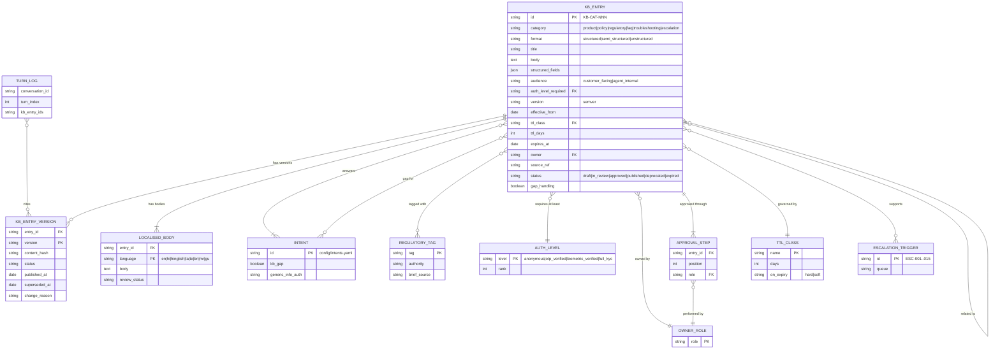

# Knowledge Base Schema and ER Model

Brief refs: A2.3 (categories, formats, versioning, regulatory tagging, TTL, access control), A4.3 (regulatory guardrails), A13.1 (catalogue), A6 (escalation). PLAN refs: section 3.3 (KB entry schema), section 4 Phase 3 items 1 and 2. Decisions: D-25 to D-29 in `docs/assumptions-and-decisions.md`. Entries live in `docs/knowledge-base/entries/` and are indexed in `README.md`. Retrieval, the maintenance workflow and the full access matrix are Day 8 and are only referenced here.

## 1. Purpose and principles

1. **Grounded only.** Every product figure comes from A13.1 (page 35 of the brief). Every regulatory statement restates the brief's regulatory text (A4.3, A6 and the Regulatory Reference Summary on pages 70 and 71). Two worked examples that the brief itself gives in A4.1 (FD 6.5% for 1 year, EMI about 17,356 for 20L at 8.5% over 20 years) are allowed only as labelled illustrations with `source_ref: A4.1` (D-26).
2. **Absence is knowledge.** Where A13.1 is silent (the `kb_gap: true` intents), the KB holds an explicit **gap-handling entry** that lists what is unknown, gives a safe statement and offers a human. The agent never fills a gap with a plausible figure (D-26).
3. **Fresh or flagged.** Every entry carries an expiry. Rates and regulatory entries expire hard; others expire soft and raise a review ticket (section 7).
4. **Auth-filtered before retrieval.** An entry above the customer's auth level is never retrieved (PLAN 3.4, `component-interfaces.md` row 6).
5. **Traceable.** Each turn logs `kb_entry_ids` with versions (A11.3), so any answer can be traced to an entry version.

## 2. Entry schema

One entry is one YAML mapping. All fields below are required unless marked optional. The validator `tests/kb/validate_kb_entries.py` enforces them.

| Field | Type | Rules |
|---|---|---|
| `id` | string | `KB-<CAT>-<NNN>`, unique and permanent (section 3) |
| `category` | enum | `product`, `policy`, `regulatory`, `faq`, `troubleshooting`, `escalation` (A2.3 six categories) |
| `format` | enum | `structured`, `semi_structured`, `unstructured` (section 4) |
| `title` | string | Short, human-readable, also indexed for retrieval |
| `body` | string | English source text. Structured: one or two sentences. Unstructured: the passage itself |
| `body_i18n` | map, optional | Reviewed bodies keyed by language (`hi`, `hinglish`, ...). Keys must equal `languages` minus `en`. In the samples the review is simulated like the approvals; a native-speaker check is still pending |
| `structured_fields` | map | Key-value or nested data. Must be `{}` for `unstructured`, at least 4 fields for `structured`, with nested lists or maps for `semi_structured` |
| `regulatory_tags` | list | Values from the tag vocabulary (section 8); `[]` if none |
| `auth_level_required` | enum | Minimum auth level to retrieve: `anonymous`, `otp_verified`, `biometric_verified`, `full_kyc` (same enum as `config/dialogue_state.schema.json`) |
| `audience` | enum | `customer_facing` (may be quoted or paraphrased) or `agent_internal` (steers the agent, never quoted verbatim) (D-29) |
| `version` | semver | `MAJOR.MINOR.PATCH` (section 6) |
| `effective_from` | date | ISO date the version goes live |
| `ttl_class` | enum | One of the six classes in section 7 |
| `ttl_days` | int | Must equal the class default |
| `expires_at` | date | `effective_from + ttl_days` (the PLAN's `ttl/expires_at`) |
| `owner` | string | Accountable role (not a person) |
| `approval_chain` | list | Ordered roles that must approve; at least 2; the last is the final approver |
| `source_ref` | string | Brief section(s) or decision the content comes from, for example `A13.1` or `A4.3; Appendix p71` |
| `languages` | list | Languages that have a reviewed body; always includes `en`. Codes follow the state schema: `en`, `hi`, `hinglish`, `ta`, `te`, `bn`, `mr`, `gu` |
| `intents` | list | Intent IDs from `config/intents.yaml` the entry can answer (section 10); at least one |
| `status` | enum | `draft`, `in_review`, `approved`, `published`, `deprecated`, `expired`. All sample entries are `published` (the approvals are simulated) |
| `escalation_triggers` | list, optional | ESC IDs (`ESC-001` to `ESC-015`) the entry supports or points to |
| `gap_handling` | bool, optional | `true` on gap entries |
| `gap_for` | list, optional | Intent IDs the gap entry covers; required on gap entries |

Fields added to the PLAN list: `audience`, `ttl_class`/`ttl_days`, `status`, `intents`, `escalation_triggers`, `body_i18n`, `gap_handling`/`gap_for`. They exist to make retrieval filtering, TTL handling and gap handling testable.

## 3. ID naming convention

`KB-<CAT>-<NNN>` where `<CAT>` is a three-letter category code and `<NNN>` is a zero-padded sequence per category, assigned once and never reused (a retired entry keeps its ID with `status: deprecated`).

| Category | Code | File | Typical content |
|---|---|---|---|
| product | `PRD` | `entries/product.yaml` | A13.1 catalogue facts, comparisons, illustrations |
| policy | `POL` | `entries/policy.yaml` | A4.1 to A4.3 rules the agent must follow |
| regulatory | `REG` | `entries/regulatory.yaml` | Regulation statements from the brief, with compliance tags |
| faq | `FAQ` | `entries/faq.yaml` | Short customer questions and answers |
| troubleshooting | `TRB` | `entries/troubleshooting.yaml` | Diagnostic guidance for failed or disputed items |
| escalation | `ESC` | `entries/escalation.yaml` | Handoff procedures (A6) and gap-handling entries |

The category code matches the file name, and the validator rejects an ID whose code does not match its category. Versions are not part of the ID; they live in `version` (section 6). Do not confuse `KB-ESC-nnn` (a KB entry) with `ESC-nnn` (an A6 escalation trigger).

## 4. Formats

| Format | Use | Shape | Why |
|---|---|---|---|
| `structured` | Catalogue facts, tables, trigger lists | Flat or lightly nested key-value in `structured_fields`; the body is a one or two sentence summary | Exact figures can be checked by the output safety layer against fields, not prose |
| `semi_structured` | Procedures, rule lists, comparisons | Nested lists and maps (steps, `never` lists, Q&A pairs) plus a short explanatory body | Keeps steps and prohibitions separable for templates and tests |
| `unstructured` | Policies in prose, FAQs, empathy-sensitive guidance | Natural-language passages, `structured_fields: {}` | Reads naturally and embeds well for dense retrieval |

Numeric claims in responses are checked against `structured_fields` when present, else against the body text (guardrail in `system-architecture.md` section 3.6, step 4).

## 5. ER model

Source: `diagrams/kb-er-model.mmd` (parses with the Mermaid parser).

Reading notes. The YAML files are the authoring view of `KB_ENTRY` (the current version). `KB_ENTRY_VERSION` and `LOCALISED_BODY` are storage-level tables built from the same files when the index is loaded (the version store is Day 8 detail). `related to` is expressed in the files as `KB-xxx-nnn` references inside `structured_fields` (for example `related_entries`, `known_adjacent_facts`, `product_entry`); the validator checks that each reference resolves.

## 6. Versioning

- **Semantic version per entry.** MAJOR: the meaning or a figure changes (a rate, a limit, a rule). MINOR: wording, new fields, added language. PATCH: typo or formatting. A MAJOR change on a `regulatory` or `rates` entry always repeats the full approval chain; a PATCH needs only the owner and one reviewer.
- **Live updates without interruption.** A new version is published beside the old one with its own `effective_from`. Retrieval serves the version whose `effective_from <= now < expires_at` and status is `published`; the old version stays queryable until the new one is verified and then moves to `deprecated`. No restart is needed. Staged publish and rollback mechanics are in the Day 8 maintenance workflow.
- **Immutable history.** A published version is never edited in place; a fix is a new version. The version store keeps `content_hash`, `published_at`, `superseded_at` and `change_reason` so an auditor can reproduce what the agent knew on a given date.
- **Traceability.** `kb_entry_ids` in each turn's log carry `id@version`, and every `PolicyDecision` that used the KB can be replayed against the version that was live (A11.3, `component-interfaces.md` cross-cutting rules).
- **Language parity.** When the English body changes MAJOR, `body_i18n` translations are marked stale and the entry serves English only until the translations are re-reviewed (the safe direction, since mistranslated figures are worse than English).

## 7. TTL rules

The brief requires TTL specifications for freshness (A2.3) but gives no values, so the classes below are design proposals (D-27) tuned for review load; they are config-level values to be moved to `config/parameters.yaml` on Day 13.

| `ttl_class` | `ttl_days` | On expiry | Used by |
|---|---|---|---|
| `regulatory` | 90 | Hard | `regulatory` entries |
| `rates` | 90 | Hard | Entries that carry a rate, fee, eligibility criterion, minimum amount or threshold (for example a minimum income, a SIP or purchase minimum, or a cover threshold for a medical check), or a comparison of them, including FAQ entries that restate a figure from a `rates` entry (an FAQ must not outlive its source figure) |
| `product_features` | 180 | Soft | Product entries with no rate |
| `policy` | 180 | Soft | `policy` entries |
| `faq_troubleshooting` | 120 | Soft | `faq` and `troubleshooting` entries |
| `escalation_procedure` | 365 | Soft | `escalation` entries, including gap entries (which therefore hold no figure, section 11) |

- **Hard expiry:** at `expires_at` the entry is excluded from retrieval. For a figure the agent then follows the matching gap entry; for a regulatory topic it follows KB-ESC-008 and hands off to the Compliance Helpdesk (ESC-008) rather than answering from memory.
- **Soft expiry:** the entry is still served, flagged `stale` in the log, and a review ticket goes to the owner. A soft-expired entry is excluded after a 30-day grace period (a proposal, to be confirmed in the Day 8 workflow).
- **Early warning:** the owner is alerted 14 days before `expires_at` (proposal). Day 8 adds staleness alerts and the regulatory fast-track for new RBI circulars, which resets the TTL of the affected `regulatory` entries immediately on publish.
- **Event override:** a change to A13.1 data, a new regulation or an escalation rule change forces review regardless of the TTL.
- **Sample dates.** All sample entries use `effective_from: 2026-10-01` so expiries are comparable; they are synthetic.

## 8. Regulatory tagging

`regulatory_tags` carries compliance metadata so retrieval, the output safety layer and the audit log can group answers by regime. Tags are a controlled vocabulary; the validator rejects unknown tags.

| Tag | Instrument or source (as named in the brief) | Brief source |
|---|---|---|
| `RBI_DIGITAL_LENDING` | RBI Digital Lending Guidelines (September 2022): disclosures, cooling-off, no pressure | A4.3, appendix p71 |
| `RBI_OMBUDSMAN` | Banking Ombudsman Scheme, 2006 (amended 2017): grievance redressal within 2 turns | A4.3, appendix p71 |
| `RBI_DIGITAL_PAYMENT_SECURITY` | RBI Master Direction on Digital Payment Security Controls (April 2024) | appendix p70 |
| `RBI_RESPONSIBLE_AI` | RBI Circular on Responsible AI in Financial Services (draft, 2025) | appendix p70 |
| `PCI_DSS` | PCI DSS v4.0: masking, CVV rule, logging | A4.3, appendix p71 |
| `KYC_AML` | KYC/AML requirements, PEP due diligence | A4.3, A6 |
| `SEBI_ROBO_ADVISORY` | SEBI Guidelines on Robo-Advisory (2024) | appendix p70, A13.1 |
| `IRDAI_AI_DISTRIBUTION` | IRDAI Guidelines on AI in Insurance Distribution (2024) | appendix p70, A13.1 |
| `DPDP_ACT` | Digital Personal Data Protection Act, 2023 | appendix p70 |
| `IT_SPDI_RULES` | IT (Reasonable Security Practices) Rules, 2011 | appendix p70 |
| `DICGC` | DICGC deposit cover | A13.1 |
| `TAX_80C` / `TDS` | Section 80C benefits, TDS applicable | A13.1, A4.1 |
| `EU_AI_ACT` | EU AI Act high-risk requirements (transparency) | appendix p71 |

Rules:
1. An entry whose body states a regulatory obligation must carry at least one tag, and a tagged `regulatory` entry must have the Regulatory Compliance Manager in its `approval_chain`.
2. An entry tagged with a regime is retrieved together with its gap entry when the question needs a figure the brief lacks (for example the cooling-off length: KB-ESC-019).
3. A question that maps to a tag but returns confidence below the retrieval threshold goes to ESC-008. Entries list the trigger in `escalation_triggers`.
4. Tags drive the Day 9 regulatory mapping matrix (tag, guardrail, test). NIST AI RMF and OWASP LLM Top 10 are design references, not customer-facing regimes, so they have no tag.

## 9. Authentication-level access control

`auth_level_required` is the **minimum** level a customer's session needs for the entry to be retrievable. The ordering is the one in `config/dialogue_state.schema.json`:

`anonymous` < `otp_verified` < `biometric_verified` < `full_kyc`

- **Pre-retrieval filter.** The retrieval request carries the session `auth_level`; the index applies `rank(auth_level) >= rank(entry.auth_level_required)` as a hard filter before scoring, so a higher-level entry cannot appear even as a low-ranked candidate (PLAN 3.4).
- **Default is anonymous.** Generic product, regulatory and FAQ content is public. `config/intents.yaml` marks the matching intents with `generic_info_auth: anonymous` (for example ACC-007, ACC-008, CMP-001, CMP-003, TXN-006, CRD-004, CRD-005, SEC-003). An intent whose account-specific `auth` is above `anonymous` but whose KB content is generic or a no-data gap entry (CRD-004, ACC-007) or generic credential-reset guidance (SEC-003) carries the flag, so its anonymous entries stay retrievable before step-up; it never unlocks anything account-specific.
- **Elevated entries.** Entries that describe a personal action or a guarded process carry the level the action needs: statement and transaction-dispute guidance at `otp_verified`, card unblocking at `biometric_verified`, closure and nominee handling and high-value closure at `full_kyc`.
- **Empty after filtering is not "no information".** If the filter removed the best-matching entries, the policy engine moves to `AUTH_REQUIRED` and asks for the step-up, rather than telling the customer the topic is unknown (this also avoids leaking that an entry exists).
- **Audience is separate from auth.** `agent_internal` entries (policy, escalation procedures) are mostly `anonymous`, so they are retrievable by the agent in any session because they steer behaviour (the exception is KB-ESC-007, which belongs to the `full_kyc` closure flow), but are never quoted verbatim to the customer and never shown above the customer's level. The Output Safety Layer rejects a response that copies an `agent_internal` body.
- **Detection rules are separate internal entries.** Customer-facing guidance stays generic and anonymous; any rule that reveals how fraud or takeover is detected (for example KB-TRB-011, the reset-after-contact-change check) lives in its own `agent_internal` entry at the level at which it is applied (`otp_verified`, after verification), so an anonymous session can never retrieve it (D-30).
- **Session rules.** Session timeout of 5 minutes and re-authentication follow KB-POL-003 and D-05; when a session drops to `anonymous`, elevated entries drop out of retrieval immediately.
- The complete access matrix (intent by auth by action by entry class) is Day 8.

## 10. Linking entries to intents

- `intents` lists every intent the entry can answer. The link is many-to-many: an entry may serve several intents, and an intent is served by several entries (for example PRD-002 uses the loan products, the EMI illustration, the loan FAQ and the loan gap entry).
- Retrieval uses the NLU intent as a **soft prior** (boost) and as a hint to include the gap entry, not as a hard filter, because a misclassified intent must not hide the right entry (`nlu-pipeline-overview.md` low-confidence paths).
- All intent IDs are validated against `config/intents.yaml`; the validator lists any intent with no entry. Three conversation-management intents (CMP-004 feedback, GEN-005 language switch, GEN-006 closure) intentionally have none, because they are answered by templates and need no knowledge.
- **Gap links.** The ER model shows this as a separate `gap for` relationship (KB_ENTRY to INTENT, from `gap_for`), distinct from `answers`. A gap entry holds no data and is `anonymous`; its intent carries `generic_info_auth: anonymous` when the intent's own `auth` is higher (D-31). The four `kb_gap: true` intents each have at least one gap entry: ACC-007 (KB-ESC-012), CRD-004 (KB-ESC-013), PRD-003 (KB-ESC-011, KB-ESC-014), GEN-008 (KB-ESC-015). Further gap entries cover topics the taxonomy notes call out (international transfer charges, card and loan fees, insurance premiums, ombudsman and cooling-off details) and one generic unknown-question fallback (KB-ESC-020).

## 11. Gap-handling entries

Gap entries have `category: escalation`, `gap_handling: true`, `gap_for: [<intents>]` and a fixed shape in `structured_fields` (semi-structured):

| Key | Meaning |
|---|---|
| `unknown` | The facts the KB does not hold. They must never be stated |
| `safe_statement` | A short, honest sentence the agent may say (templates can wrap it) |
| `known_adjacent_facts` | KB IDs the agent can offer instead |
| `offer` | Next steps (human handoff, callback request, illustration) |
| `never` | Specific fabrications to block, also used to seed hallucination-trap tests on Day 10 |

The first reply to a gap never contains a number that is not in the KB. If the customer insists, the escalation path is a human handoff, not a guess.

Two further rules. (1) A gap entry states no figure in its body or fields; it points to the entry that holds the figure (for example KB-ESC-014 points to KB-PRD-002). Gap entries live 365 days while `rates` entries expire hard at 90, and section 7 makes the gap entry the fallback after a hard expiry, so a figure copied into a gap entry would be served after its source expired. (2) The generic fallback KB-ESC-020 is `unstructured` prose with empty `structured_fields`; the five keys above apply to the `semi_structured` gap entries.

## 12. Storage layout

One YAML file per category in `docs/knowledge-base/entries/` (D-25). Each file has an `anchors:` block (shared roles and the sample effective date, reused with YAML aliases) and an `entries:` list. Per-entry fields are always written out in full, so an entry can be read on its own. The file approach was chosen over JSONL for reviewability in a documentation-first repo; the loader reads `entries:` and ignores `anchors:`. Run `python tests/kb/validate_kb_entries.py` from the repo root to validate.

## 13. Validation checks

The validator confirms: all files parse; no flow-map comma slips; required fields present; unique IDs; ID code matches category and file; enums valid (category, format, auth, audience, status, ttl class, language, regulatory tag); `expires_at = effective_from + ttl_days` and `ttl_days` equals the class value; `approval_chain` has at least 2 steps; intent and ESC IDs exist; format rules (section 2); `body_i18n` keys match `languages`; every `KB-xxx-nnn` reference resolves; every `kb_gap` intent has a gap entry; gap entries are `escalation` entries with a non-empty `gap_for`, the five section 11 keys when semi-structured, and no figure; every number in a title, body, translated body or field (YAML numbers included) belongs to a short allow-list of figures that appear in the brief (A13.1, A4.1, A6, A1.2, instrument years in the appendix); every number followed by a time unit (days, hours, minutes, turns, years) belongs to an allow-list of brief or decision durations, and "working/business days" phrasing is always reported (a timeline commitment, A9.2); at least 55 entries with all six categories and all three formats present. The allow-list check is a net, not a proof: numbers in the entries were also checked manually against the PDF (see the Day 7 CHANGELOG entry).
