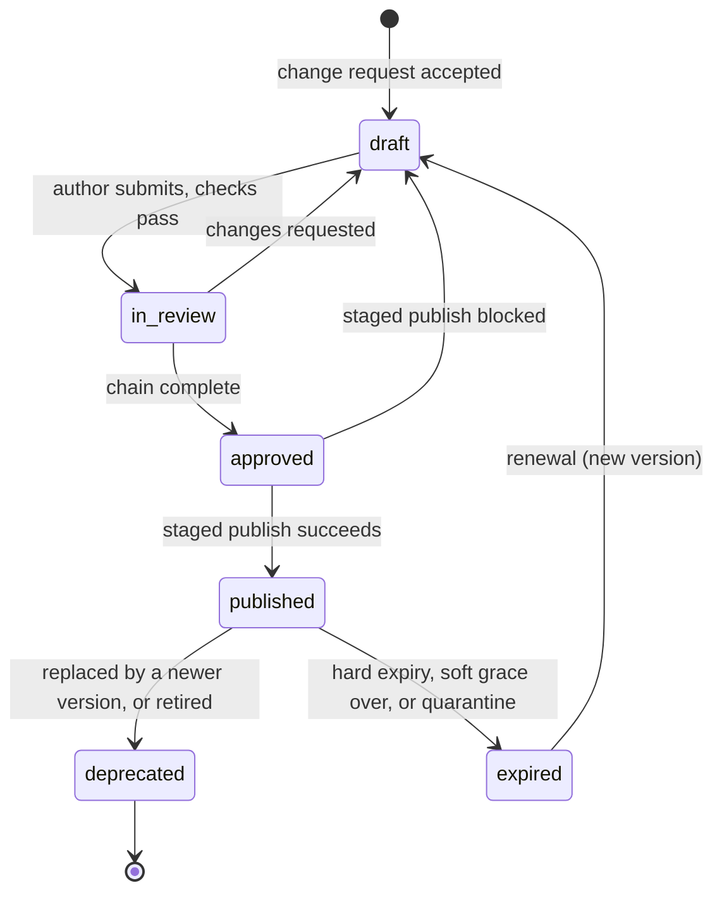

# Knowledge Base Maintenance Workflow

Brief refs: A2.3 (version control for live updates without interruption, regulatory tagging, TTL for freshness), A5 (KB updates are the first-choice target of the learning loop; safety-adjacent changes need HITL), A11.1 (KB staleness from delayed regulatory updates: likelihood Medium, impact Critical, P0; mitigation "regulatory fast-track, staleness alerts, version-tagged KB with expiry"), A10 (audit). Plan refs: section 4 Phase 3 item 5. Decisions: D-27 (TTL classes, 14-day alert, 30-day grace, confirmed here), D-29, D-46, D-47. Schema, versioning rules and statuses: `kb-schema.md` sections 2, 6 and 7. How the retriever applies status and expiry: `retrieval-pipeline.md` section 5. Access rules: `access-control-matrix.md`.

Everything here is a design. The sample entries carry simulated approvals, and no real reviewers or tools are named. Timings marked "proposal" are logged in D-46 and have no basis in the brief.

## 1. Principles

1. **One path in.** Every change to what the agent knows goes through this workflow: a new entry, a figure change, a translation, a retirement, a correction from a supervisor, a change request from the learning pipeline. There is no side door, including for urgent fixes (section 5 is a faster path with the same approvers, not a bypass).
2. **Four eyes.** The author and every approver are different people. A person never approves their own change, even if they hold an approver role.
3. **Immutable history.** A published version is never edited in place. A fix is a new version (kb-schema section 6).
4. **Fail toward silence, not toward a guess.** When an entry may be wrong or has expired, the safe state is that it is absent from retrieval, so the gap entry or ESC-008 takes over (kb-schema section 7).
5. **Grounded only.** A figure enters the KB only with a `source_ref` to the brief's catalogue (A13.1), its worked examples (A4.1) or its regulatory text; a gap entry holds no figure (D-26). In a real deployment the source would be the product master and the regulator's published text; the control is the same.
6. **Tested before and after.** A publish is blocked by automated checks and verified after going live; rollback is always available and always quick.

## 2. Roles and approval chains

The role names are the ones already used in `owner` and `approval_chain` in the entries.

| Role | Does | Cannot |
|---|---|---|
| Author (a person acting for the owner role) | Writes or updates the entry, sets `source_ref`, `version`, `regulatory_tags`, `auth_level_required` and `audience` | Approve own change |
| Customer Experience | Owns escalation procedures, FAQs and gap entries; reviews wording and tone; step 1 or 2 for troubleshooting | Approve a figure or a regulatory statement alone |
| Product Engineering | Owns product and troubleshooting entries; confirms every figure against the catalogue (A13.1 equivalent) | Approve regulatory content |
| Risk & Compliance | Owns policy entries; second-line review of everything customer-facing; checks the advice boundary, disclosures and the guardrail links | Publish |
| Regulatory Compliance Manager | Owns regulatory entries; confirms regulatory text and tags; final approver for product entries; runs the regulatory fast-track | Approve own authored entries without the second approver |
| Chief Risk Officer | Final approver for policy, regulatory and escalation entries; can order a quarantine or a rollback at any time | |
| KB Operations (Product Engineering function) | Runs validation, builds the index epoch, performs staged publish and rollback, operates alerts | Approve content; a publish needs the recorded approvals |
| Supervisors and the Continuous Learning Pipeline | Raise change requests (sections 3.1 and 8) | Edit or publish |

**Approval chain by category** (as recorded in the sample entries, `approval_chain`; the last role is the final approver):

| Category | Owner | Chain | Count in sample KB |
|---|---|---|---|
| product | Product Engineering | Product Engineering, Risk & Compliance, Regulatory Compliance Manager | 12 |
| policy | Risk & Compliance | Risk & Compliance, Chief Risk Officer | 11 |
| regulatory | Regulatory Compliance Manager | Regulatory Compliance Manager, Chief Risk Officer | 11 |
| faq | Customer Experience | Customer Experience, Risk & Compliance | 11 |
| troubleshooting | Product Engineering | Product Engineering, Customer Experience, Risk & Compliance | 11 |
| escalation (including gap entries) | Customer Experience | Customer Experience, Risk & Compliance, Chief Risk Officer | 21 |

Rules that follow from `kb-schema.md`: a tagged `regulatory` entry must have the Regulatory Compliance Manager in its chain (section 8 rule 1); a MAJOR change on a `regulatory` or `rates` entry repeats the full chain; a PATCH needs the owner and one reviewer (section 6). An FAQ that restates a figure from a `rates` entry gets a Product Engineering source check in addition to its own chain (it must not outlive or contradict its source; D-32). An entry that touches the advice boundary or an escalation route (KB-POL-001, KB-ESC-008, KB-ESC-010) is safety-adjacent, so a human gate cannot be skipped by automation (A5).

## 3. Lifecycle and standard workflow

The statuses are the `status` enum: `draft`, `in_review`, `approved`, `published`, `deprecated`, `expired`.



### 3.1 Intake

Sources of a change request: a product or policy change (event override, kb-schema section 7); a regulatory change (section 5); a staleness alert (section 6); a supervisor correction or a low-confidence pattern from the retriever (section 8); a validation or audit finding; a translation review result. A request records the reason, the affected `id`s (or a new `id`), the requested priority and the requester.

### 3.2 Authoring

1. Use the entry template (the schema in `kb-schema.md` section 2). New entries take the next free `KB-<CAT>-<NNN>`; IDs are never reused.
2. Choose `format`, `auth_level_required`, `audience`, `ttl_class` and the tags by the rules in `kb-schema.md`; the access consequence is checked against `access-control-matrix.md`.
3. Every figure has a source; the author fills `source_ref`. Anything the source does not give goes to `not_in_catalogue` or `not_in_brief`, not into prose. If the knowledge is a known absence, write or update a gap entry (kb-schema section 11).
4. A gap entry and the entry it points to are changed in the same release, so the KB never contradicts itself (for example a new RD product entry is published together with the retirement of KB-ESC-011).
5. Translations (`body_i18n`) are authored from the approved English body and reviewed by a native speaker before the language is added to `languages`.
6. Run `python tests/kb/validate_kb_entries.py` locally. Failures go back to the author.

### 3.3 Review

Peer review by a person who did not write the change, outside the author's team where possible. The checklist:

- the meaning and every figure match the source; no new number outside the source;
- audience and auth level are correct (nothing that reveals detection logic is customer-facing, nothing account-specific sits at `anonymous`; D-29, D-30);
- the advice boundary holds: facts, no recommendation (KB-POL-001);
- mandatory disclosures are not weakened (KB-POL-008);
- wording is brand-aligned and free of promises and timelines (KB-POL-007);
- links resolve (`related_entries`, `known_adjacent_facts`, `product_entry`) and the intents are right.

Automated gates run on every submission, in this order: the validator; a diff of numbers against the allow-list; the retrieval regression (section 4); a hallucination-trap run for gap entries (every `never` item is a trap query that must not produce the item).

### 3.4 Compliance approval

The roles in the category chain approve in order and record a decision with comments. Any rejection returns the change to `draft` with the comment. Approval by the final approver moves the status to `approved`. Approvals are time-boxed per step by the owner of the queue; the approver is the accountable person and cannot be skipped. If a role holder is absent, a delegate named in advance by the same function approves, never the author.

### 3.5 Staged publish

1. KB Operations builds a **candidate index epoch** from all `published` entries plus the approved change. The currently live epoch is untouched.
2. **Pre-publish gates on the candidate epoch** (a failure sets the status back to `draft`):
   - validator passes;
   - retrieval regression: the gold query set and `tests/kb/boss-level3.yaml` run on the candidate; no gold query regresses past its allowed margin, and the safety counters of `retrieval-pipeline.md` section 15.1 are all zero (auth leaks, expired or unpublished entries returned, a figure in a gap answer, a regulatory-uncertain case not escalated);
   - for a safety-adjacent change, the fixed safety suite (200 or more cases, 100% pass; A5) and HITL sign-off;
   - the dependent artefacts are consistent: templates, prompt layer references, tests that name the entry.
3. **Shadow run.** The candidate epoch answers live queries in parallel without serving them; differences in decision (`answer`, `gap`, `escalate_esc_008`) and confidence are reviewed for the changed topics.
4. **Canary ladder** for ordinary changes: 1%, then 5%, then 25%, then 100% of conversations, the same ladder as the learning pipeline (A5, PLAN 3.7). Between stages a **circuit breaker** compares guardrail and retrieval metrics against the live epoch: auth assertion failures, a drop in mean confidence or in containment for the affected intents, a rise in ESC-008 raises, CSAT. A breach rolls the epoch back automatically and pages the owner.
5. **Cut-over** is an atomic switch of the live `index_epoch`. Conversations in progress finish their current turn on the epoch they started, then use the new one. No restart is needed (A2.3 "live updates without interruption").
6. **Post-publish verification** of the changed topics by sampled supervisor review. The old version is moved to `deprecated` only after verification (kb-schema section 6), and stays in the version store.

### 3.6 Rollback

- **Trigger**: circuit breaker; a failed post-publish check; an incident; an order from the Chief Risk Officer, the Regulatory Compliance Manager (for regulatory content) or the entry owner.
- **Mechanism**: the live `index_epoch` pointer is switched back to the previous epoch. Because versions are immutable and epochs are snapshots, this is a metadata operation that takes effect on the next turn, and it does not depend on the failed change.
- **Expiry caveat**: a rollback restores the old text but not a fresh lifetime. If the restored version is past its `expires_at`, the retriever will correctly exclude it (hard) or flag it (soft). The rollback runbook therefore checks the dates first; if the old text is out of date, the fix is a new PATCH version of the old text with a new `effective_from`, approved by the owner and one reviewer, plus the source check in section 6.
- **After a rollback**: the failed version becomes `deprecated` with `change_reason`, the incident is logged, the cause goes into the gold set as a regression case, and the change returns to `draft`.
- **Rollback is drilled** with the same cadence as the circuit-breaker drills of the learning pipeline.

### 3.7 Translations

A MAJOR English change marks all `body_i18n` bodies stale and the entry serves English only until the translations are re-reviewed (kb-schema section 6). The retriever flags `translation_unavailable` and the agent offers Hindi, English or a human. Adding a language is a MINOR change. Native-speaker review for Hindi and Hinglish is still pending in the sample KB (open question, Day 7).

## 4. Release gates in one table

| Gate | When | Blocks on |
|---|---|---|
| Validator | Submission, pre-publish | Any schema, ID, enum, TTL, number or reference failure |
| Retrieval regression | Pre-publish, nightly | Gold-query regression, any safety counter above zero, boss-set failures |
| Hallucination traps | Pre-publish (gap entries) | A `never` item produced, or any figure not in the KB |
| Safety suite | Safety-adjacent changes | Any failure (100% required) |
| Human approvals | Before `approved` | Missing or rejected step in the chain |
| Canary and circuit breaker | During rollout | Metric breach, auth assertion failure |
| Post-publish sample review | After 100% | Wrong or misleading answer found; rollback |

## 5. Regulatory fast-track

Purpose: A11.1 rates "KB staleness from delayed regulatory updates" as impact Critical, P0, with "regulatory fast-track, staleness alerts, version-tagged KB with expiry" as mitigation. A new RBI circular, or any amendment to an instrument the KB cites (the tags of `kb-schema.md` section 8), must reach the live KB faster than the ordinary ladder allows, without lowering the approval standard.

```
circular received -> impact analysis -> quarantine if needed -> draft -> two approvals
   -> expedited gates -> publish at 100% with live rollback -> TTL reset -> 100% sampled review
```

| Step | Who | What |
|---|---|---|
| 1. Receipt and logging | Regulatory Compliance Manager (monitoring function) | Log the circular, issuer, date and the instrument tag affected. The log entry starts the P0 clock |
| 2. Impact analysis | Regulatory Compliance Manager with KB Operations | Find affected content by tag: all entries with the tag, their related entries, gap entries, templates and prompt-layer text that quote the rule, and tests that depend on it (the "regulatory change simulator" idea in the innovation backlog diffs the circular against all four) |
| 3. Quarantine, if the current text may now be wrong | Regulatory Compliance Manager or Chief Risk Officer | The entry's status is set to `expired` with `change_reason: quarantine`. The retriever excludes it, so the agent answers regulatory questions through KB-ESC-008 and ESC-008 (Compliance Helpdesk) instead of stating possibly wrong text. Proposal (D-46): quarantine decision on the same working day as the confirmed impact |
| 4. Draft | Regulatory Compliance Manager (author) | New MAJOR version of each affected `regulatory` entry; changed figures re-sourced; gap entries updated if the circular supplies a fact that was a gap, or creates one |
| 5. Approval | Regulatory Compliance Manager is the author, so approval comes from the Chief Risk Officer plus a second Risk & Compliance reviewer (four-eyes). Product and FAQ entries that restate the rule use their own chains, run in parallel, not in sequence | The full chain is repeated for a MAJOR change; only the waiting is shortened |
| 6. Expedited gates | KB Operations | Validator; retrieval regression for the affected tags and intents only (not the whole set); the targeted part of the safety suite for guardrail-linked rules (regulatory mapping tests of Day 9). HITL stays |
| 7. Publish | KB Operations | Straight to 100% on a new epoch (no 1, 5, 25 ladder), with instant rollback. The risk of a wrong entry is covered by steps 5 and 6 and by step 9 |
| 8. TTL reset | KB Operations | Entries confirmed unchanged by the review are re-attested as PATCH versions with a new `effective_from`, so their 90-day `regulatory` lifetime restarts on publish (kb-schema section 7). The dated approval is the evidence |
| 9. Heightened monitoring | Risk & Compliance | Review all turns on the affected topics for the first period (proposal: 100% sampling until the Regulatory Compliance Manager closes the item), plus a dashboard of ESC-008 raises and retrieval confidence for those topics |
| 10. Close-out | Regulatory Compliance Manager | Update `regulatory-mapping.md` (Day 9) and the tests; record elapsed times; post-mortem if the target was missed |

Target time from receipt to live is an open question for the Risk Committee (D-46); the brief gives none. Until a target is agreed, the quarantine in step 3 is the control that bounds exposure. The fast-track never skips: the validator, the retrieval safety counters, a regulatory-owner approval, a second approver, or the audit record.

## 6. Staleness alerts tied to `ttl_class`

TTL values are D-27 (still proposals for the Risk Committee). This section confirms how they are monitored.

| `ttl_class` | Days | Expiry type | Alert 14 days before `expires_at` | At `expires_at` | After |
|---|---|---|---|---|---|
| `regulatory` | 90 | Hard | Owner (Regulatory Compliance Manager) and Chief Risk Officer | Entry excluded; P0 alert to owner and Chief Risk Officer; ESC-008 handles questions on the topic | Renewal is a new version (section 3 or 5) |
| `rates` | 90 | Hard | Owner (Product Engineering or Customer Experience for FAQs) and Risk & Compliance | Entry excluded; P0 alert; the matching gap entry answers (no figure) | Renewal needs the source check |
| `product_features` | 180 | Soft | Owner | Entry still served, flagged `stale`; review ticket to the owner | At 30 days after `expires_at` (grace over) the entry is excluded; the ticket goes to the final approver of the chain |
| `policy` | 180 | Soft | Owner (Risk & Compliance) | Same as above | Same as above |
| `faq_troubleshooting` | 120 | Soft | Owner | Same as above | Same as above |
| `escalation_procedure` | 365 | Soft | Owner (Customer Experience) | Same as above | Same as above |

The 14-day early warning and the 30-day grace are D-27 proposals, confirmed here as the working values; both move to `config/parameters.yaml` on Day 13.

Worked dates for the sample KB (`effective_from: 2026-10-01`, synthetic): `regulatory` and `rates` entries expire 2026-12-30, so the owner alert is 2026-12-16; `faq_troubleshooting` entries expire 2027-01-29 (alert 2027-01-15; soft grace ends 2027-02-28); `product_features` and `policy` entries expire 2027-03-30 (alert 2027-03-16; grace ends 2027-04-29); `escalation_procedure` entries expire 2027-10-01 (alert 2027-09-17; grace ends 2027-10-31).

Operating rules:

1. **Staleness board.** A dashboard lists every entry by days to expiry, class, owner and status, with the entries currently served `stale` at the top. It is part of the daily operational view.
2. **Alerts cannot be silenced.** An alert is closed only by renewal, retirement or a recorded decision by the chain's final approver to let a soft entry lapse.
3. **Renewal.** An unchanged entry is re-attested as a PATCH version with a new `effective_from` (owner plus one independent reviewer, as for any PATCH). The reviewer re-checks the `source_ref`; for `rates` entries Product Engineering confirms the catalogue is unchanged, and for `regulatory` entries the Regulatory Compliance Manager confirms the instrument has not been amended. A changed figure or rule is a MAJOR version and repeats the full chain.
4. **Event override.** A change to catalogue data, a regulation or an escalation rule forces review regardless of the TTL (kb-schema section 7); this is the intake of section 3.1.
5. **Retriever signals.** The retriever logs `stale_ids` served and hard-expiry exclusions (`retrieval-pipeline.md` section 14). A hard-expiry exclusion that actually affected a customer answer is an incident-grade event: it means a renewal was missed.
6. **Dependent entries.** The 90-day FAQ entries that restate a figure (D-32) are renewed in the same batch as their source entry.
7. **Owner capacity.** The number of entries expiring in the next 14 days per owner is shown on the board so renewals can be levelled; staggered `effective_from` dates (not all on one day as in the sample KB) are recommended once the KB is live.

## 7. Versioning and the version store

Semantic versions follow kb-schema section 6. The version store holds, per `id` and version: `content_hash`, `status`, `published_at`, `superseded_at`, `change_reason`, the approver decisions and the validation and evaluation results. Operating rules:

- A version has exactly one `effective_from`; two versions of one `id` may both be `published` only for the overlap between a new version's cut-over and the verification of the old one, and the retriever serves the one with the later `effective_from`.
- The `index_epoch` history is kept, so "what could the agent say on date X" is answered by the epoch live at X plus the version store (A11.3 reproducibility).
- `kb_entry_ids` in each turn log carry `id@version`, so a wrong answer is traced to the exact text.

## 8. Feedback into the workflow

Retrieval and supervisor signals create change requests; they never change the KB directly (A5: KB updates are the first target of the learning loop, but they use this gate).

| Signal | Produces |
|---|---|
| Supervisor correction that cites a wrong or missing KB fact | Change request to the owner of the entry; if the fact is genuinely unknown, a gap entry instead of a guessed figure |
| Intents with a rising share of confidence below 0.65 (`retrieval-pipeline.md` section 14) | Authoring request: a new entry, a better title or body wording, or a gap entry |
| ESC-008 raises that the Compliance Helpdesk answers the same way repeatedly | Request to add the confirmed fact to the KB through the regulatory path |
| Hallucination-trap or safety-suite failure | Entry fix and a new regression case |
| CSAT or repeat-contact analysis tied to a KB answer | Review of the entry's content and clarity |

Gold queries are added for every incident so the same failure cannot return unseen.

## 9. Audit trail

Every step writes an immutable, encrypted audit record (A10; encryption, access control and retention are specified in `docs/compliance/audit-logging.md` sections 8 to 10, not repeated here).

| Event | Fields recorded |
|---|---|
| Change request | id, requester role, reason, affected IDs, priority, time |
| Authoring and review | author (pseudonymised staff ID and role), version, `content_hash`, diff against the previous version, reviewer and checklist result |
| Approval | each approver role and pseudonymised ID, decision, comment, time |
| Automated checks | validator output, regression metrics, safety-suite result, trap-run result, with the candidate `index_epoch` |
| Publish | epoch, stages reached, canary metrics, circuit-breaker readings, cut-over time |
| Rollback or quarantine | trigger, ordering role, epochs, reason |
| Alerts | alert type, entry, owner, time raised, time acknowledged, closure and reason |
| Retirement | decision, approvers, replacement mapping |

Each customer turn that used the KB logs `kb_entry_ids` (`id@version`) and `index_epoch`, which links the conversation to this record. Auditors can therefore reproduce which approved text produced which answer.

## 10. Retirement

1. **Proposal**: the owner gives the reason (product withdrawn, rule superseded, duplicated content) and the replacement, if any.
2. **Impact check**: find inbound references (`related_entries`, `known_adjacent_facts`, `product_entry`), gold queries, tests, templates and prompt text that name the entry. All are updated or replaced first.
3. **Absence is knowledge**: if a customer could still ask about the retired topic, write the gap entry first (for example a withdrawn product gets a KB-ESC-style gap entry) so the agent says it cannot confirm, rather than going quiet or guessing.
4. **Approval** by the same chain as the category.
5. **Publish** by the normal path (section 3.5). The status becomes `deprecated`; the entry is removed from the index on the next epoch and kept in the version store for audit.
6. **IDs are never reused** (kb-schema section 3). A deprecated entry keeps its `id` and its history.
7. A retired gap entry is replaced in the same release as the new product or rule entry that fills the gap.

## 11. Metrics for the process

Time in each status (draft to published); share of entries inside their TTL; entries served `stale` and for how long; hard-expiry exclusions that touched a customer answer (target zero); rejection rate at each gate; fast-track elapsed time against whatever target the Risk Committee sets; rollback count and cause; share of change requests from learning signals versus from regulatory events. These feed the weekly metrics view (Day 12).

## 12. Open questions

- Risk Committee: confirm the TTL classes, the 14-day alert, the 30-day grace and a fast-track time target (D-27, D-46).
- Whether the Chief Risk Officer, or a delegate, may approve a fast-track alone when the Regulatory Compliance Manager is the author; the current rule requires two people.
- Native-speaker review capacity for Hindi and Hinglish bodies, and for the secondary languages if translated bodies are added.
- Where the product master and the regulatory register live in a real deployment (the sample KB uses the brief as the source).
